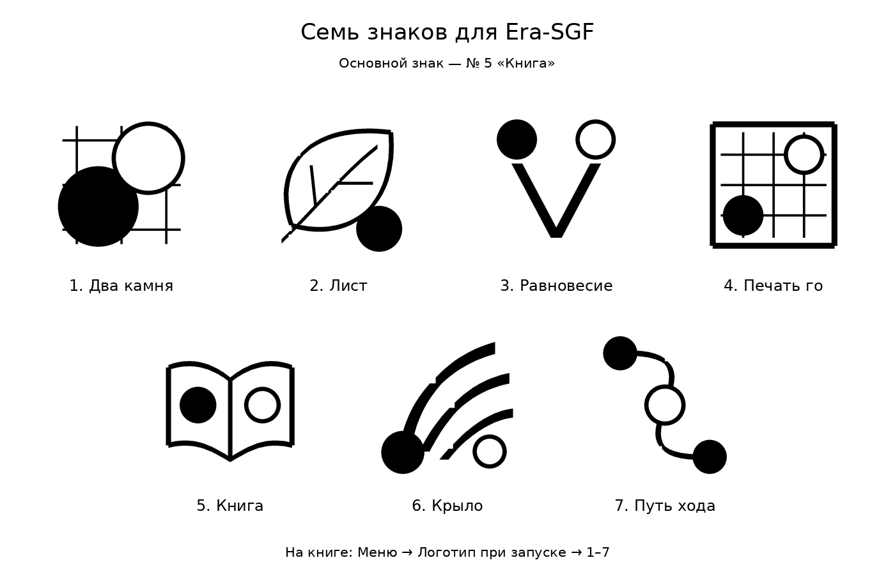

# Варианты личного знака

Семь оригинальных геометрических чёрно-белых вариантов для выбора владельца:

1. **Два камня** — чёрный и белый камни на фрагменте сетки.
2. **Лист** — лист, прожилка и небольшой камень.
3. **Равновесие** — буква V с двумя камнями.
4. **Печать го** — квадратная печать с сеткой и камнями.
5. **Книга** — открытая книга с двумя камнями.
6. **Крыло** — три пера и два камня.
7. **Путь хода** — плавная линия с чередующимися камнями.

Основным выбран **№ 5 — «Книга»**. Он используется по умолчанию; все семь вариантов
остаются доступны в приложении: «Меню → Логотип при запуске». Выбор сохраняется,
приложение показывает его вместе с номером версии при следующем запуске.

Метки рисуются общим C++-компонентом `src/logos.cpp`; SVG-файлы в `assets/logos/`
генерируются из тех же операций. Чтобы обновить подборку, выполни `make all`, затем
`python3 scripts/generate-logo-previews.py`. Для PNG-подборки нужен Pillow на компьютере;
на книге дополнительные библиотеки или файлы изображений не требуются.
